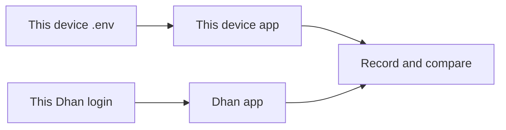

# Go-live proof runs

Run these steps by hand on the device you are testing. Each device has its own empty database and its own `.env`, copied from `.env.example`. The app reads one Dhan client id and one access token from that file (`DHAN_CLIENT_ID`, `DHAN_ACCESS_TOKEN`). A token copied from another machine, another account, or a chat log is a failed setup.

Do not write a client id, access token, order id, or a past fill into this file. Prices, quantities, and order ids are copied from the screen into the record sheet while you run the proof. A number taken from another machine is a fail.

Every live check compares this device's app with the Dhan app logged into the same account. An empty trade book is a pass when that Dhan login also has no fills. Trades that belong to a different login are a fail.

Leave `LIVE_TRADING_ENABLED=false` until proof 1 passes on this device. Do not check the four open boxes in `ROADMAP.md` until the record sheet for this device is filled and every row is a pass. Quantity is 1 share. Market hours for proofs 2, 3, and 4 are 09:15–15:30 IST on a weekday.

## 0. Prepare this device

1. Clone the repo on this device. Do not copy `backend/.env` or the database from another machine.
2. Copy `.env.example` to the env file this process actually loads. Fill only this device's database password, JWT secret, and the Dhan client id and access token for the account you will log into on this device. Leave `LIVE_TRADING_ENABLED=false`.
3. Note this device's public IPv4 and whitelist that address at Dhan for this account. An address that belongs to another device does not count.
4. Start Postgres, Redis, the API, and the worker with this device's own database.
5. Create the admin from the console on this device. Sign in as that admin.
6. Open the dashboard.
   - Pass: the book matches this Dhan login. It may be empty.
   - Fail: the book shows fills from another login. Stop. The token on this device is the wrong account. Replace it with this account's token and reload. Do not continue with the foreign book.

Write the device name and a short account label (a name you choose, not the token) on the record sheet.

## 1. Paper session

No Dhan order is placed. With `LIVE_TRADING_ENABLED=false`, paper runs on the simulated feed.

1. Pick one liquid NSE equity symbol. This document calls it `SYMBOL`. You choose it on this device. Quantity is 1.
2. Put `SYMBOL` on the terminal watchlist.
3. For each engine you will actually trade, and for each formula you will actually trade, assign it to this user with paper mode on and `SYMBOL` in the params.
4. Start that assignment and wait for one bar to close.
5. Open the local trades for this user.

Pass when that bar produced a stored trade with paper set, an entry price, and an exit price. Repeat until every engine and formula you will use has its own row. An engine you will not use does not need a run.

Fail when the trade is missing, paper is off, or the entry or exit is empty. Do not turn live trading on to finish this step.

Record the engine or formula name, the bar time, entry, exit, and P&L from the screen.

## 2. Fill confirmation

Do this only after proof 1 passed, and only during 09:15–15:30 IST.

1. On this device only, set `LIVE_TRADING_ENABLED=true`. Restart the API and the worker so they load that flag and this device's token.
2. Open the dashboard again and compare it with the Dhan app for this same login. If they disagree, stop and fix the token before any order.
3. Place one live order for 1 share of `SYMBOL` through the app (the strategy assignment you will use, switched off paper, or a terminal order on that symbol). The order must go through the app so the fill wait in `backend/app/broker/order_ops.py` (`place_once`) is the path under test.
4. Watch the Dhan app and the app trade row.

Pass when all of these are true:

- Dhan shows the fill for this account.
- The app leaves the trade not OPEN until the broker status is FILLED. A row marked OPEN before that fill is a fail.
- The entry price on the app equals the traded price shown on Dhan. Do not type an expected price before the fill.

Write the order id and the fill price from the screen into the record sheet. Leave the 1 share open for proof 3.

## 3. Kill switch

Start from the open 1-share position in proof 2. Flattening is implemented in `backend/app/strategy/recovery.py`.

Use one of these:

- On the Risk page, kill that strategy. That calls `POST /api/risk/{map_id}/kill`. The running executor must still be up so it flattens the open trade.
- Or, as admin, use the global kill. That calls `POST /api/risk/live-kill`, which blocks new live orders and flattens open trades.

Pass when all of these are true:

- Dhan shows `netQty` 0 for `SYMBOL` on this account.
- A new live order is rejected while the kill is active.
- The killed badge or the kill alert is visible.

Write the flatten order id from the screen. Clear the global kill only when you are ready for proof 4 (`DELETE /api/risk/live-kill`). Clearing it does not by itself place an order.

## 4. Restart

1. Open 1 share of `SYMBOL` again through the app, the same way as proof 2.
2. Before stopping anything, write down the position quantity and the day's risk counters (daily P&L and consecutive losses on that strategy).
3. Restart the API and the worker. Leave the Dhan position open while they come back.
4. Reopen the app and the Dhan app for this same login.

Pass when the position quantity matches the note, the risk counters match the note, and no second order was sent. A restored position that immediately buys or sells again is a fail.

Then flatten this account before you leave it. A later device must use its own account, not this leftover position.

## Record sheet

Fill one row per proof on this device. Leave cells blank until you read them from the screen. Do not paste a token, client id, or a fill from another account.

| Proof | Device | Date | Account label | Symbol | Order id | Fill price | Pass or fail | Notes |
| --- | --- | --- | --- | --- | --- | --- | --- | --- |
| 0. Prepare |  |  |  |  |  |  |  | Book matches this login, or it is empty on both sides |
| 1. Paper |  |  |  |  |  |  |  | One row per engine and formula you will use |
| 2. Fill |  |  |  |  |  |  |  | OPEN only after FILLED |
| 3. Kill |  |  |  |  |  |  |  | netQty 0, new order rejected |
| 4. Restart |  |  |  |  |  |  |  | Same qty and counters, no second order |

## What this runbook does not use

- No sample client id or access token.
- No sample order id.
- No expected P&L or fill from a previous account.
- No shared database between devices.

Pass or fail is whether this device's app matches the Dhan login on this device.
