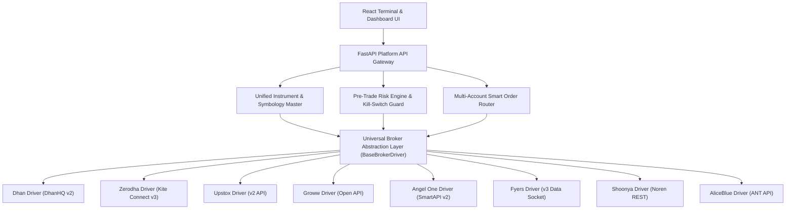
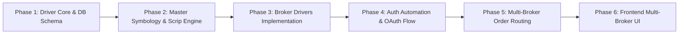

# Architecture Plan: Universal Multi-Broker Algo Trading Engine

This document outlines the architectural blueprint and engineering roadmap for transforming **algo-platform** into a broker-agnostic, enterprise-grade algorithmic trading platform capable of seamlessly integrating with all major Indian stock brokers (**Zerodha, Dhan, Upstox, Groww, Angel One, Fyers, Shoonya, AliceBlue**, etc.).

---

## 1. Executive Summary & Architecture Vision

The target architecture is a **Micro-Kernel / Pluggable Driver Architecture (SPI Pattern)** with a **Universal Broker Abstraction Layer (UBAL)**.

Core modules (Terminal, Strategy Engines, Formula Evaluator, Risk Management, Copy Trading) will interact strictly with standardized abstraction interfaces, completely decoupled from vendor SDKs or individual broker protocol quirks.



---

## 2. Supported Brokers Target Matrix

| Broker | Primary Protocol | Auth Mechanism | Live Marketfeed | Order Routing | Rate Limits |
| :--- | :--- | :--- | :--- | :--- | :--- |
| **Dhan** | REST + Binary WS | Permanent Access Token | Binary Packet WS | DhanHQ v2 | 10 req/sec |
| **Zerodha** | REST + Binary WS | Daily OAuth2 + Request Token | Kite Ticker (Binary) | Kite Connect v3 | 3 req/sec (Orders), 10 req/sec (Quotes) |
| **Upstox** | REST + Protobuf WS | Daily OAuth2 + Auth Code | Protobuf WS v2 | Upstox API v2 | 25 req/sec |
| **Groww** | REST + JSON WS | OAuth2 / Client Secret | Groww WebSockets | Groww Trading API | 10 req/sec |
| **Angel One**| REST + SmartWS | API Key + Client Code + TOTP | SmartAPI WS 2.0 | SmartAPI REST | 10 req/sec |
| **Fyers** | REST + Binary WS | OAuth2 + Daily App Token | Data Socket v3 | Fyers Order API | 10 req/sec |
| **Shoonya** | REST + JSON WS | Client ID + Password + TOTP | Noren WebSockets | Noren REST | 5 req/sec |
| **AliceBlue** | REST + WebSockets | API Key + Encryption Key | ANT WebSocket | ANT REST API | 10 req/sec |

---

## 3. Core Architectural Components

### 3.1. Universal Broker Abstraction Layer (UBAL)
Every broker adapter implements a strict asynchronous Python base interface:

```python
from abc import ABC, abstractmethod
from typing import AsyncGenerator

class BaseBrokerDriver(ABC):
    """Unified asynchronous interface implemented by every broker plugin."""

    # ── Session & Authentication ──────────────────────────────────────────
    @abstractmethod
    async def authenticate(self, credentials: dict) -> bool: ...

    @abstractmethod
    async def refresh_session(self) -> bool: ...

    @abstractmethod
    async def health_check(self) -> dict: ...

    # ── Order Execution & Management ─────────────────────────────────────
    @abstractmethod
    async def place_order(self, req: UnifiedOrderRequest) -> UnifiedOrderResult: ...

    @abstractmethod
    async def modify_order(self, order_id: str, changes: OrderModification) -> UnifiedOrderResult: ...

    @abstractmethod
    async def cancel_order(self, broker_order_id: str) -> bool: ...

    @abstractmethod
    async def get_order_status(self, broker_order_id: str) -> UnifiedOrderStatus: ...

    @abstractmethod
    async def get_orders(self) -> list[UnifiedOrder]: ...

    @abstractmethod
    async def get_trades(self) -> list[UnifiedTrade]: ...

    # ── Portfolio & Balances ─────────────────────────────────────────────
    @abstractmethod
    async def get_positions(self) -> list[UnifiedPosition]: ...

    @abstractmethod
    async def get_holdings(self) -> list[UnifiedHolding]: ...

    @abstractmethod
    async def get_funds(self) -> UnifiedFunds: ...

    # ── Market Data Streaming ────────────────────────────────────────────
    @abstractmethod
    async def stream_ticks(self, symbols: list[str]) -> AsyncGenerator[UnifiedTick, None]: ...

    @abstractmethod
    async def fetch_history(self, symbol: str, timeframe: str, start: str, end: str) -> list[dict]: ...
```

---

### 3.2. Universal Data Normalization
Eliminates vendor-specific terminology across exchanges, product types, and order types:

```python
class UniversalExchange(str, Enum):
    NSE_EQ = "NSE_EQ"
    NSE_FNO = "NSE_FNO"
    BSE_EQ = "BSE_EQ"
    BSE_FNO = "BSE_FNO"
    MCX_COMM = "MCX_COMM"

class UniversalProduct(str, Enum):
    INTRADAY = "MIS"      # Intraday margin (MIS / I)
    DELIVERY = "CNC"      # Cash and carry delivery (CNC)
    NORMAL   = "NRML"     # Normal futures/options carry-forward (NRML)
    MARGIN   = "MTF"      # Margin Trading Facility

class UniversalOrderType(str, Enum):
    MARKET = "MARKET"
    LIMIT  = "LIMIT"
    STOP_LOSS_LIMIT  = "SL"
    STOP_LOSS_MARKET = "SL-M"
```

Each driver encapsulates its own internal bi-directional mapping dictionary:
* **Zerodha**: `INTRADAY` -> `"MIS"`, `DELIVERY` -> `"CNC"`
* **Dhan**: `INTRADAY` -> `"INTRADAY"`, `DELIVERY` -> `"CNC"`
* **Upstox**: `INTRADAY` -> `"I"`, `DELIVERY` -> `"D"`
* **Angel One**: `INTRADAY` -> `"INTRADAY"`, `DELIVERY` -> `"DELIVERY"`

---

### 3.3. Master Symbology & Scrip Mapping Engine
Brokers use distinct internal numeric identifiers for identical traded assets:
* *Reliance Equity:*
  * Canonical Key: `NSE:RELIANCE`
  * Zerodha Token: `738561`
  * Dhan Security ID: `1333`
  * Upstox Instrument Key: `NSE_EQ|INE002A01018`
  * Angel One Token: `2885`

**Implementation:**
1. **Automated Daily Ingestion Worker (Celery Beat):** Runs at 06:00 AM daily before market open. Downloads official scrip dumps from NSE/BSE and broker instrument endpoints.
2. **Canonical Indexing:** Matches by ISIN and standard exchange trading symbol.
3. **Redis L1 Cache:** Stores fast lookup hashes:
   ```python
   # Look up broker-specific scrip identifier in sub-millisecond time:
   broker_token = await redis.hget(f"sym:map:{broker_name}", canonical_symbol)
   ```

---

### 3.4. Unified Market Data Ingestion & Multiplexing
Instead of spinning up multiple redundant WebSocket connections per strategy or per user:
1. A single **Central MarketFeed Multiplexer** connects to the primary streaming broker (e.g. Dhan or Zerodha KiteTicker).
2. The multiplexer decodes ticks (binary packets or protobuf) into standardized JSON ticks:
   ```json
   {
     "symbol": "NSE:RELIANCE",
     "ltp": 2540.50,
     "open": 2530.00,
     "high": 2555.00,
     "low": 2525.00,
     "close": 2532.00,
     "volume": 1284500,
     "timestamp": 1700000000
   }
   ```
3. Publishes ticks to Redis Pub/Sub channel `tick:{symbol}`.
4. All strategies, the Terminal page, and the Risk Engine consume from this unified Redis stream without needing to know which broker delivered the tick.

---

### 3.5. Multi-Account Smart Routing & Copy Trading
Enables master-child trade replication across distinct broker platforms:
* **Master Account:** e.g., Dhan (low latency, zero brokerage on select APIs).
* **Child Accounts:** e.g., Zerodha Kite, Upstox, Groww.
* **Execution Flow:**
  1. Terminal or Strategy issues an order for `NSE:RELIANCE`, Qty `100`.
  2. The **Smart Router** looks up the active execution profile and account allocations.
  3. Dispatches parallel execution tasks across all configured child broker accounts via asynchronous tasks (`asyncio.gather()` / Celery workers).
  4. Collects and reconciles order IDs, execution prices, and slippage in a unified trade log.

---

### 3.6. Automated Authentication & Session Lifecycle
* **Headless Auto-Login (TOTP):** For brokers supporting programmatic authentication (Angel One, Shoonya, AliceBlue), the backend stores encrypted credentials (`api_key`, `client_code`, `password`, `totp_secret`). A morning cron job at 08:30 AM uses `pyotp` to generate TOTP codes and authenticate automatically.
* **OAuth2 Web Redirect Center:** For brokers requiring user consent logins (Zerodha, Upstox, Groww), the platform provides:
  * Route: `/api/brokers/{broker}/auth-url` (generates login URL with state token).
  * Callback: `/api/brokers/{broker}/callback` (exchanges auth code for access token and securely stores it in Postgres).
  * 1-Click "Re-authenticate" button on the UI with visual session status badges.

---

## 4. Enhanced Database Schema

```sql
-- 1. Supported Broker Registry
CREATE TABLE brokers (
    id VARCHAR(32) PRIMARY KEY,              -- 'dhan', 'zerodha', 'upstox', 'groww', 'angel'
    display_name VARCHAR(64) NOT NULL,
    auth_type VARCHAR(32) NOT NULL,          -- 'oauth2', 'totp_auto', 'static_token'
    supports_options BOOLEAN DEFAULT TRUE,
    supports_marketfeed BOOLEAN DEFAULT TRUE,
    rate_limit_per_sec INTEGER DEFAULT 10,
    is_enabled BOOLEAN DEFAULT TRUE
);

-- 2. User Connected Broker Accounts
CREATE TABLE user_broker_accounts (
    id UUID PRIMARY KEY DEFAULT gen_random_uuid(),
    user_id UUID REFERENCES users(id) ON DELETE CASCADE,
    broker_id VARCHAR(32) REFERENCES brokers(id),
    account_label VARCHAR(64),               -- e.g. "Primary Zerodha Account"
    client_id VARCHAR(128) NOT NULL,
    encrypted_credentials JSONB NOT NULL,    -- AES-256 encrypted payload
    is_active BOOLEAN DEFAULT TRUE,
    paper_trading BOOLEAN DEFAULT FALSE,
    token_expires_at TIMESTAMP WITH TIME ZONE,
    created_at TIMESTAMP WITH TIME ZONE DEFAULT NOW()
);

-- 3. Universal Instrument & Scrip Master
CREATE TABLE instrument_master (
    id BIGSERIAL PRIMARY KEY,
    canonical_symbol VARCHAR(64) NOT NULL UNIQUE, -- e.g. 'NSE:RELIANCE'
    isin VARCHAR(32),
    name VARCHAR(128),
    exchange VARCHAR(16) NOT NULL,
    segment VARCHAR(16) NOT NULL,
    tick_size NUMERIC(8, 4) DEFAULT 0.05,
    lot_size INTEGER DEFAULT 1,
    broker_tokens JSONB NOT NULL             -- {"dhan": "1333", "zerodha": "738561", "upstox": "NSE_EQ|INE002A01018"}
);

-- 4. Multi-Account Copy Trading Allocations
CREATE TABLE copy_trade_routes (
    id UUID PRIMARY KEY DEFAULT gen_random_uuid(),
    user_id UUID REFERENCES users(id) ON DELETE CASCADE,
    master_account_id UUID REFERENCES user_broker_accounts(id),
    child_account_id UUID REFERENCES user_broker_accounts(id),
    multiplier NUMERIC(5, 2) DEFAULT 1.0,
    is_enabled BOOLEAN DEFAULT TRUE
);
```

---

## 5. Phased Implementation Roadmap



### Phase 1: Core Interface & Database Architecture
* Implement `BaseBrokerDriver` abstract class with strict typing.
* Build Pydantic models for universal orders, positions, funds, and ticks.
* Run database migrations for dynamic broker accounts and credential encryption.

### Phase 2: Master Symbology & Scrip Engine
* Create the `InstrumentMaster` service and Celery scheduled task.
* Ingest instruments from NSE, BSE, Dhan, Zerodha, and Upstox dumps.
* Set up Redis key-value mapping for fast canonical symbol lookups.

### Phase 3: Broker Driver Implementations
* **Dhan Driver:** Complete refactor to match `BaseBrokerDriver`.
* **Zerodha Driver:** Implement `kiteconnect` REST & KiteTicker binary feed.
* **Upstox Driver:** Implement `upstox-python-sdk` v2 REST and Protobuf feed.
* **Groww Driver:** Implement Groww OpenAPI client.
* **Angel One Driver:** Implement SmartAPI with automated TOTP session management.

### Phase 4: Auth Management & OAuth Callback Center
* Build unified OAuth2 callback handlers for Zerodha, Upstox, and Groww.
* Implement the morning 08:30 AM automated TOTP token refresh scheduler.
* Add health-check endpoints returning per-broker latency and status.

### Phase 5: Multi-Broker Order Routing & Copy Trading
* Update the Strategy Executor and Terminal Page to dispatch orders via `BrokerAccount`.
* Implement parallel child account order dispatcher with slippage checks.
* Integrate pre-trade risk checks across all connected accounts.

### Phase 6: Frontend Multi-Broker Management
* Create the "Add Broker" modal with broker logo grid and dynamic credential inputs.
* Build the "Live Broker Account Matrix" showing margin, latency, and connection state.
* Add account selection dropdowns across Terminal and Strategy Assignment views.
